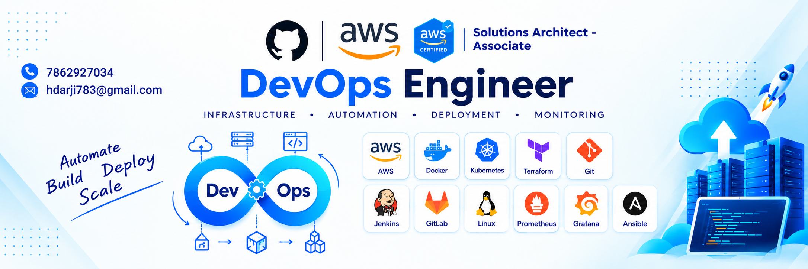

<!-- ============================================= -->
<!--                 GITHUB BANNER                 -->
<!-- ============================================= -->

  

 

<h1 align="center">
Hi, I'm Hardik Darji 👋
</h1>

<h3 align="center">
Cloud & DevOps Engineer
</h3>

AWS Certified Solutions Architect – Associate  • Cloud Infrastructure • DevOps • Automation

  

---

## 🚀 About Me

I'm a **Cloud & DevOps Engineer** focused on building, automating, and troubleshooting cloud infrastructure and production-ready environments.

I have hands-on experience with **AWS, Terraform, Docker, Kubernetes, Amazon EKS, GitHub Actions, Helm, Argo CD, Linux, Git, and Infrastructure as Code.**

My work focuses on:

- ☁️ Cloud infrastructure and automation
- 🏗️ Infrastructure as Code
- 🐳 Containerization and orchestration
- 🔄 CI/CD automation
- 🔁 GitOps deployments
- 📊 Monitoring and observability
- 🤖 AI-assisted DevOps and troubleshooting
- 🐧 Linux administration and troubleshooting

I document my hands-on work through real-world projects, technical notes, labs, and my **90 Days of DevOps** portfolio.

---

## 🛠️ Tech Stack

### ☁️ Cloud & DevOps

  

### 💻 Programming & Scripting

  

### 🐧 Operating Systems, Databases & Tools

  

### 📊 Monitoring & Observability

  

---

## 💡 What I Work With

| Area | Technologies |
|------|--------------|
| ☁️ Cloud | AWS, EC2, S3, IAM, VPC, ALB, Auto Scaling, CloudFront, Route 53 |
| 🏗️ IaC | Terraform |
| 🐳 Containers | Docker, Docker Compose |
| ☸️ Kubernetes | Kubernetes, Amazon EKS, Helm |
| 🔄 CI/CD | GitHub Actions |
| 🔁 GitOps | Argo CD |
| 📊 Observability | Prometheus, Grafana, Loki |
| 🐧 Linux | Administration, networking, permissions, processes, troubleshooting |
| 🤖 Automation | Python, Bash |
| 🔧 Version Control | Git, GitHub |

---

## 📌 Featured Projects

### 🚀 90 Days of DevOps

> A hands-on Cloud & DevOps engineering portfolio covering the journey from **Linux and networking to production-ready cloud infrastructure, GitOps, observability, and AI-assisted DevOps.**

**Linux → Networking → Git → Docker → AWS → Terraform → CI/CD → Kubernetes → Helm → GitOps → Observability → AIOps**

Key implementations include:

- AWS infrastructure and networking
- Terraform Infrastructure as Code
- Docker containerization
- GitHub Actions CI/CD
- Kubernetes & Amazon EKS
- Helm application packaging
- Argo CD GitOps deployments
- Prometheus, Grafana & Loki observability
- AI-assisted Kubernetes troubleshooting

🔗 [90 Days of DevOps](https://github.com/hdarji1912/90DaysOfDevOps)

---

## ☁️ AWS Projects

> Hands-on AWS projects covering compute, networking, scalability, storage, and web hosting.

- [AWS Static Website Hosting with S3 & CloudFront](https://github.com/hdarji1912/AWS-SAA-Hands-On-Learning-Documentation)
---

## 🏗️ Terraform Projects

> Infrastructure as Code projects focused on provisioning and managing AWS infrastructure using Terraform.

- [TerraWeek](https://github.com/hdarji1912/TerraWeek)

---

## ⚡ CI/CD & GitHub Actions

> Hands-on CI/CD automation and DevSecOps workflows using GitHub Actions.

### GitHub Actions Capstone ⭐

Production-style CI/CD pipeline featuring:

- Reusable workflows
- Docker image builds
- Automated testing
- Trivy security scanning
- Dependabot
- SARIF security reporting
- Artifacts
- Deployment automation

🔗 [GitHub Actions Capstone](https://github.com/hdarji1912/devops-learning-hub)

---

## 🐧 Linux Projects

> Hands-on Linux administration, monitoring, and troubleshooting labs.

- [Linux Monitoring & Troubleshooting Lab](https://github.com/hdarji1912/linux-server-health-monitor)

---

## 🏆 Certifications

- AWS Certified Solutions Architect – Associate (SAA-C03) 
- Python Certification  - Hacker Rank
- SQL Certification     - Hacker Rank

  

---

## 💼 Open To Opportunities

I'm currently open to opportunities in:

- **DevOps Engineer**
- **Junior DevOps Engineer**
- **Cloud Engineer**
- **Cloud Support Engineer**
- **Cloud Operations Engineer**
- **Platform Engineer**

Open to **full-time Cloud & DevOps opportunities**.

---

## 📊 GitHub Statistics

<table align="center">
  <tr>
    <td width="50%">
      
    </td>
    <td width="50%">
      
    </td>
  </tr>
</table>

  

---

## 🐍 Contribution Snake

---

## 🤝 Let's Connect

  

  

 

---

## 🚀 Why This GitHub Exists

This GitHub is my **Cloud & DevOps engineering portfolio** — where I build, automate, troubleshoot, and document real-world projects.

My focus:

- Build practical projects
- Automate repetitive tasks
- Improve troubleshooting skills
- Document technical learning
- Work with production-oriented cloud and DevOps practices

> **Learn. Build. Automate. Deploy. Improve.**

---
